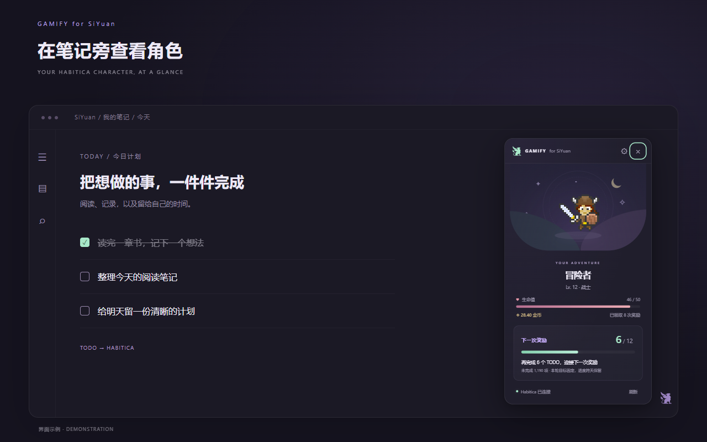
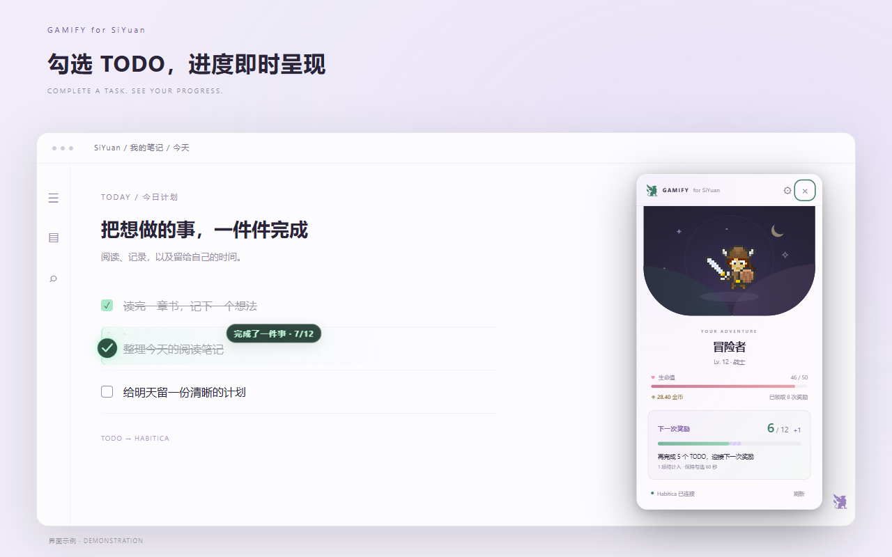
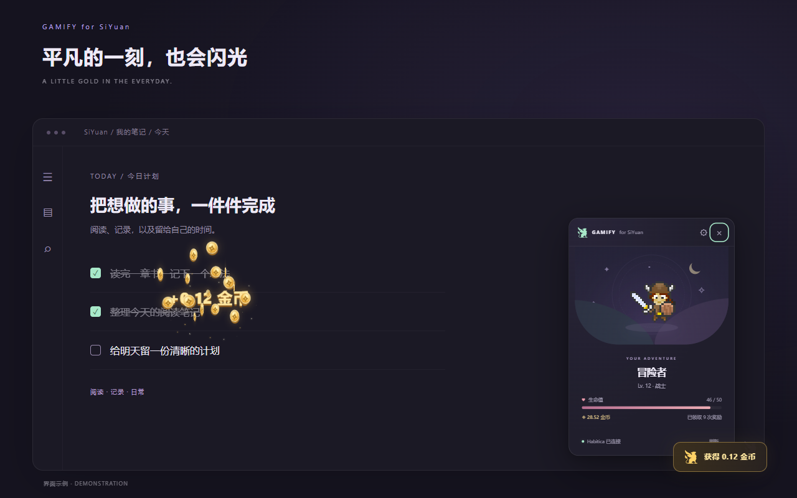
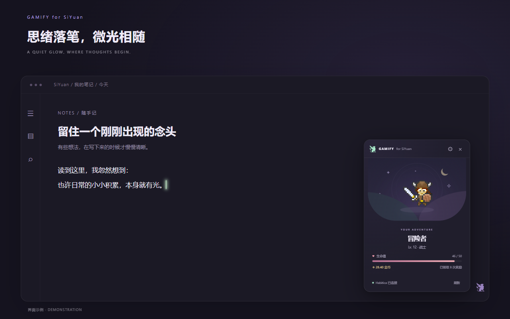
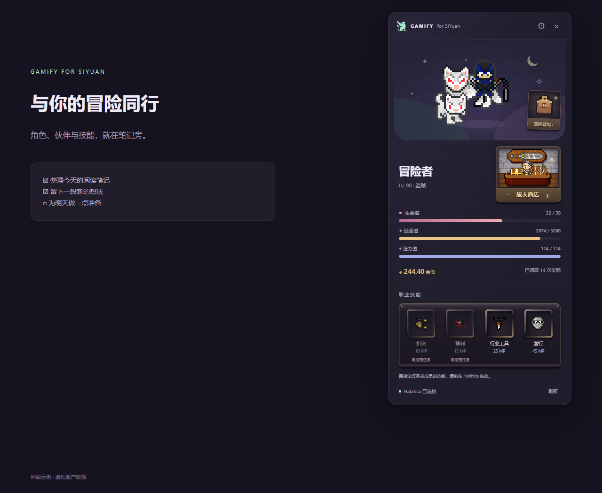
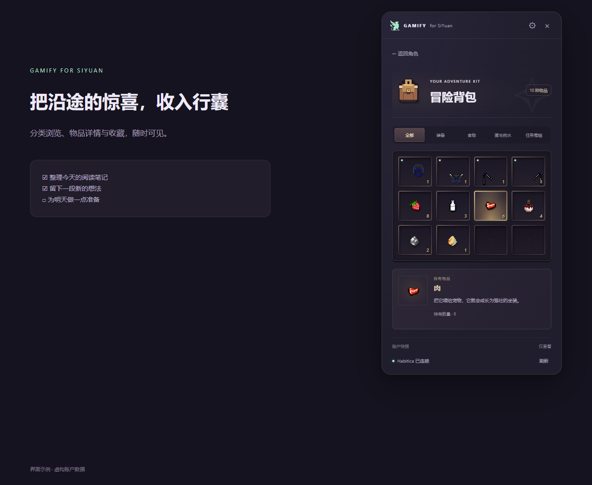
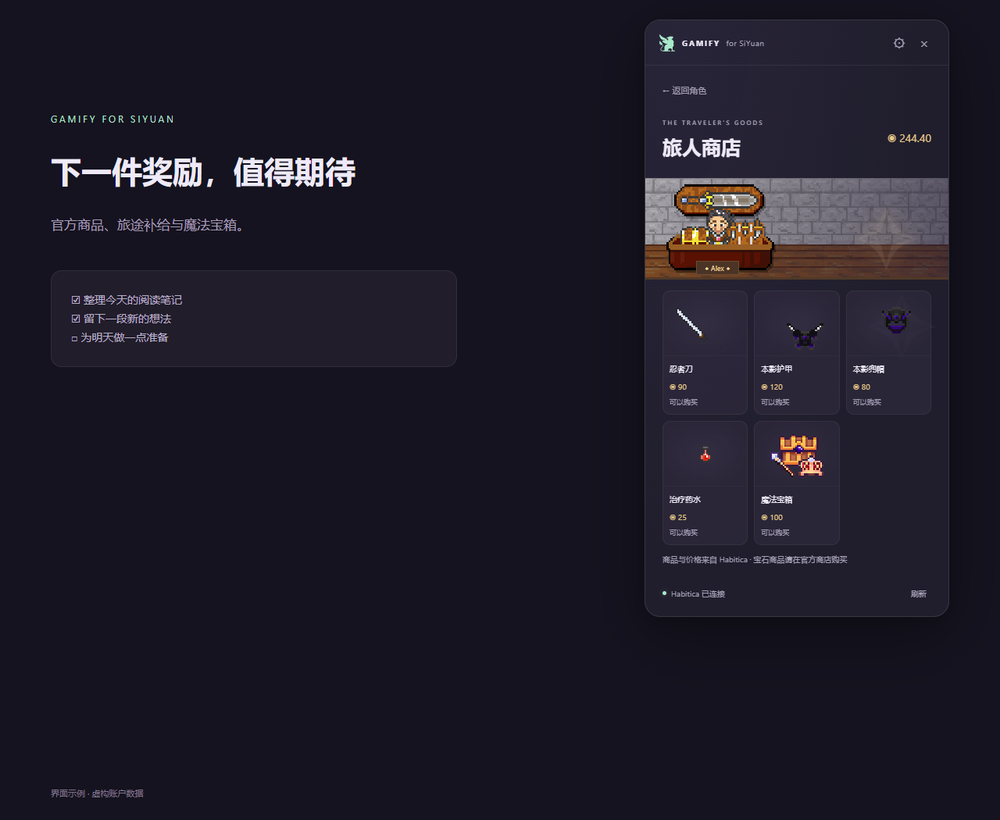
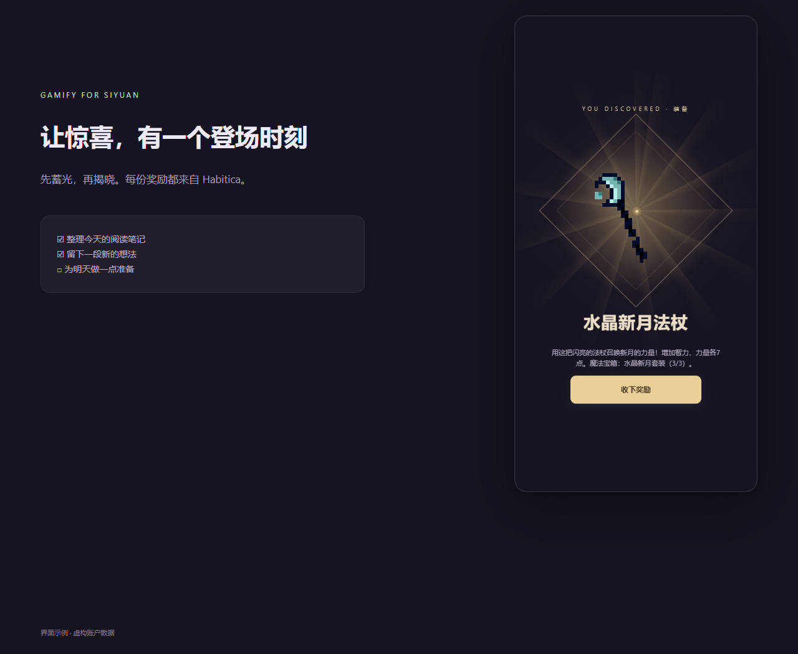
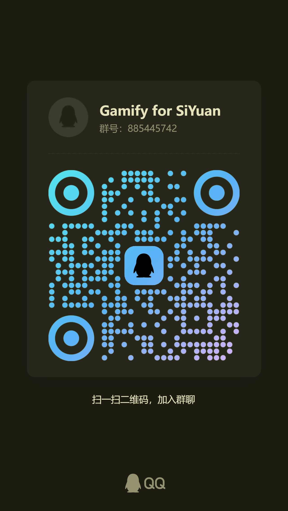

# Gamify for SiYuan

Your Habitica companion, alongside your notes.

Your character, mount and pet travel together, with health, experience and mana at a glance. The RPG action bar supports skills that need no task selection; targeted skills show a clear disabled state.

Browse your inventory and find your next reward in the traveler’s shop. Inventory is read-only. Availability and prices come from Habitica; gem purchases open in the official shop.

Give each surprise its moment. Equipment, food and experience from the Enchanted Armoire are determined by Habitica.

The character and inventory share cached data; static content is reused without frequent background polling. Screenshots use fictional account data.

[Documentation](Document.md)

## Community and feedback

Join the Gamify for SiYuan user group to share ideas, ask questions and report issues.

QQ group: **885445742**. Scan the QR code below to join.

Contact the author: [hucharles@foxmail.com](mailto:hucharles@foxmail.com)
