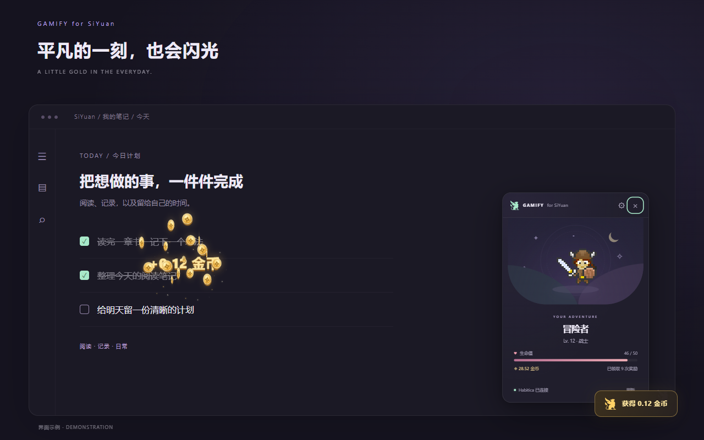
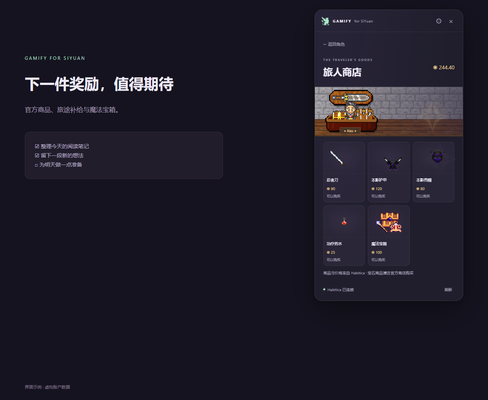
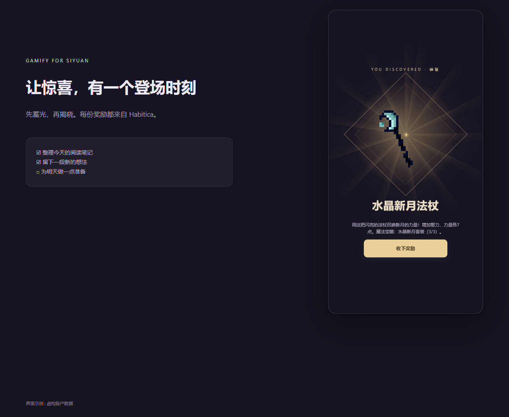

# Gamify for SiYuan

你的 Habitica 角色，与你的笔记同行。

角色、坐骑与宠物一起出发，生命、经验和法力一目了然。RPG 技能栏支持无需指定任务的技能；需指定目标的技能会明确禁用。

浏览你的背包，在旅人商店挑选下一件奖励。背包目前仅供查看；商品资格与价格以 Habitica 返回为准，宝石商品请前往官方购买。

为惊喜留一个登场时刻：魔法宝箱的装备、食物或经验均由 Habitica 决定。

角色、背包共享缓存，静态内容长期复用，不进行后台高频轮询。截图为虚构账户数据。

[使用说明](Document.md)

## 交流与反馈

欢迎加入 Gamify for SiYuan 用户群，交流使用体验、反馈问题和分享想法。

QQ 群：**885445742**，也可以扫描下方二维码加入。

作者邮箱：[hucharles@foxmail.com](mailto:hucharles@foxmail.com)
