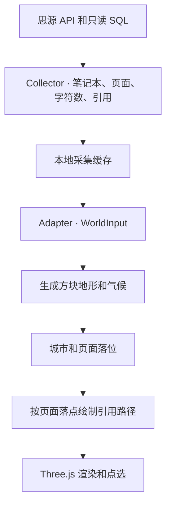

# NoteWorld Demo

在仓库根目录运行以下命令。Key 由本地服务进程读取。思源地址默认是
`http://127.0.0.1:6806`，可用 `NOTE_WORLD_SIYUAN_URL` 修改。

```powershell
npm run build
npm run preview:build
$env:NOTE_WORLD_SIYUAN_TOKEN = Read-Host '思源 API Key' -MaskInput
npm run preview:note-world
```

打开 [地图](http://127.0.0.1:4181/) 并点击「从思源刷新」。下次打开时会读取
`cache/snapshot.json`。缓存由服务写入，已加入 Git 忽略规则。使用 Live Share 时转发
NoteWorld 服务监听的 4181 端口。浏览器通过这个服务采集和写缓存。

[素材画廊](http://127.0.0.1:4181/dev/note-world/presentation/asset-gallery.html)
仍可独立打开。早期 Canvas 和体素实验放在 `legacy/`。



修改生成规则从 `domain/world.ts`、`domain/terrain.ts` 和 `domain/cities.ts` 入手。
引用路径在 `domain/routes.ts`，素材在 `presentation/assets.ts`。验证 SQL 和生成流程可运行
`node --import tsx tools/verify-note-world.ts`。
